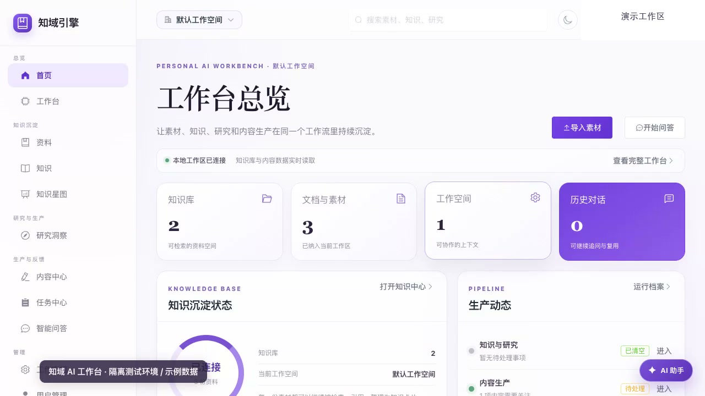

# 知域 AI 工作台

知域为企业团队提供多租户 AI 知识服务。项目以企业知识库 RAG 为基础，围绕“素材 → 知识 → 研究 → 行动”建设 AI 工作台，并配套独立的运维控制面。仓库包含应用源码、数据库迁移、自动化测试和面向使用者的开发部署文档；生产数据、真实部署配置、原始发布证据和内部项目档案不纳入公开源码。

## 开源与使用边界

本仓库中的项目源码采用 [Apache License 2.0](LICENSE)。许可证适用范围、第三方依赖的各自许可、演示媒体和数据资产的边界请参阅[开源边界说明](OPEN_SOURCE_BOUNDARY.md)。Apache-2.0 不授予知域名称、商标或服务标识的使用权；仓库中的演示视频、预览图及第三方素材也应按其来源和单独许可使用。

开源版不含支付、订单、商业授权、订阅销售或兑换码功能；应用功能不按商业套餐分级，资源默认不设套餐上限。自托管部署者可以在运维控制面配置资源保护限制。Apache-2.0 允许第三方商用本仓库代码；商业运营实现由独立私有发行版本维护，不属于本开源版本。

## 项目解决的问题

企业资料通常分散在文档、知识库和团队流程中。知域将文件与文本导入、知识整理、检索问答和研究任务连接起来，帮助团队在有来源依据的资料上完成查询和分析。租户、用户、工作空间和资源访问由服务端管理，保证不同组织的数据边界。

## 主要能力

### 企业知识库与 RAG

- 支持文档与文本导入、解析、分块、向量化和索引管理。
- 通过语义检索与关键词检索组合召回内容，并接入重排和大模型生成。
- 提供多轮对话、引用来源、文档管理、健康检查和索引诊断等能力。
- 通过可替换的模型与向量存储适配层连接 OpenAI 兼容服务、Ollama 和 Qdrant 等后端。

### AI 工作台

- **素材中心**：集中管理文件、链接和粘贴文本，跟踪处理状态并支持失败重试。
- **知识中心**：整理知识卡片及其来源证据，支持审核、版本管理和回滚；合适的知识可回流到 RAG 检索基座。
- **研究中心**：研究项目需明确提出问题并选择内部资料/数据集或指定来源 URL，生成带引用证据的研究运行与报告；不会自动扫描所有上传资料。未配置分析模型时以证据包为主，不自动生成行业结论。
- **工作台首页**：汇总任务、活动和搜索结果，并按租户范围返回数据。
- **学习诊断**：提供分阶段诊断与练习流程，并校验报告和练习资源的属主访问权限。
- **内容中心**：管理选题、由研究报告生成的草稿、人工编辑审核、发布记录和指标快照；它不是本地上传资料的汇总库。文件应先进入素材中心/知识库，只有主动将研究报告转成草稿后才进入内容中心。平台自动发布不属于当前承诺能力。

当前产品不提供微信公众号、抖音、知乎的发布或数据连接入口。平台渠道和连接器范围以实际可见的产品入口及当前发布 Profile 为准。

### 独立运维控制面

`ops-center/` 是独立部署的 FastAPI 服务和 Web 控制台，供授权运维人员查看租户与用量，并执行受控的资源配额、索引等管理操作。它通过内部网关调用业务服务，使用单独的认证、角色授权、操作标识和审计链路；不直接访问业务数据库。

## 架构与数据流

主服务按单向依赖分层：

```text
Vue 前端 → FastAPI API → Service 用例编排 → Core 领域逻辑 → Infrastructure 适配器
                                                    ├─ PostgreSQL：租户、用户、任务与业务记录
                                                    ├─ Qdrant：向量集合与检索
                                                    └─ Redis / Celery：缓存、异步任务与调度
```

典型知识问答流程为：上传或导入资料 → 解析与分块 → 生成向量并写入索引 → 按租户和工作空间检索 → 组合相关片段与来源 → 调用模型生成答复。长耗时处理通过后台任务运行；应用同时提供健康检查、结构化日志和监控接入。

运维控制面与主业务服务分开部署，通过受保护的内部 API 通信。资源 ID 必须由服务端鉴权；内部调用需要有效凭据和来源限制，写操作带有操作者及幂等操作标识。

## 技术栈

| 层次 | 主要技术 |
|---|---|
| Web 前端 | Vue、TypeScript、Vite |
| API 与服务 | Python、FastAPI、Pydantic、SQLAlchemy 2 |
| 关系数据 | PostgreSQL；本地开发可按配置使用 SQLite |
| 向量检索 | Qdrant；另有内存实现用于本地开发与测试 |
| 缓存与任务 | Redis、Celery |
| 模型接入 | OpenAI 兼容 API、Ollama 等可配置提供方 |
| 部署与监控 | Docker Compose、Prometheus、Grafana |

## 仓库结构

```text
.
├── enterprise-rag-v2/       # 主业务服务、前端、迁移、任务和测试
├── ops-center/              # 独立运维 API、控制台和联调脚本
├── documents/               # 产品、架构、开发、部署和学习文档
├── release/                 # 发布能力 Profile 与通用治理说明（不含环境原始证据）
├── scripts/quality/         # 结构、边界和发布质量检查
├── DEPLOYMENT_TOPOLOGY.md   # 自托管部署拓扑示例
└── AGENTS.md                # 项目开发和发布约定
```

## 开发与运行

1. 阅读[开发快速开始](documents/development/getting-started.md)，按需准备 Python、Node.js、PostgreSQL、Redis 和 Qdrant。
2. 根据目标服务进入 [`enterprise-rag-v2/`](enterprise-rag-v2/README.md) 或 [`ops-center/`](ops-center/README.md)，分别配置依赖和环境变量。
3. 从对应的 `.env.example` 复制本地配置，并在本机填写自己的值。真实密钥、访问令牌、会话文件和生产配置不得提交。监控 Compose 使用的 RabbitMQ API 地址通过本地 `RABBITMQ_API_URL` 提供。首次运行 `scripts/ensure_default_admin.py` 时，须在本地环境中单独设置 `DEFAULT_ADMIN_EMAIL` 与 `DEFAULT_ADMIN_PASSWORD`；脚本不再包含默认管理员凭据。
4. 开发时参考[文档中心](documents/README.md)；发布前按[发布 Runbook](documents/deployment/release-runbook.md)和当前 `release/release-profile.json` 执行检查。

常用质量门禁命令：

```bash
bash scripts/quality/run-quality-gates.sh --full
```

门禁覆盖代码结构、模块边界、发布配置、文档链接、语法和服务测试。具体发布验收还要满足 Profile 中当前版本列出的自动化与人工证据要求。

## 文档入口

- [文档中心与当前技术口径](documents/README.md)
- [系统架构与安全设计](documents/architecture/overview.md) / [安全架构](documents/architecture/security.md)
- [开发快速开始](documents/development/getting-started.md)
- [生产部署与备份恢复](documents/deployment/production-guide.md) / [备份恢复](documents/deployment/backup-recovery.md)
- [发布 Runbook](documents/deployment/release-runbook.md) / [发布治理说明](release/README.md)

## 项目演示

[▶ 观看知域 AI 工作台演示视频](documents/demo/zhiyu-ai-workbench-demo.mp4)（约 48 秒，涵盖首页、工作台、资料、知识、知识星图、行业知识研究、内容中心和任务中心）。视频按当前普通用户导航录制，不展示未开放渠道和 Agent 运行中心；使用隔离测试实例中的独立测试租户与虚构样例资料，不连接生产服务。



## 版本与范围说明

发布 Profile 当前为 `draft`。2.3.0 的历史候选记录不代表当前 `main` 已完成同一候选的发布验收，也不代表生产环境正在运行该版本。原始环境证据保存在仓库外的受控位置；公开 Profile 用于列出验收范围，不作为生产部署证明。设计文档用于说明目标和计划，不能单独作为功能已上线的证明。
